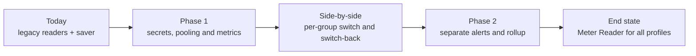

# MdReader

A lightweight, free Windows desktop application for reading and displaying Markdown files with a beautiful, formatted view.

## Features

- **Multiple File Formats**: Open local `.md` and `.markdown` files, or load from URLs
- **Tabbed Interface**: Work with multiple Markdown files simultaneously in separate tabs
- **Session Persistence**: Automatically saves and restores your open tabs between sessions
- **File Integration**: 
  - Double-click `.md` files in Windows Explorer to open
  - Drag and drop files onto the application
  - "Open With" context menu support
- **Zoom Controls**: Easily adjust text size from 50% to 300%
- **Search Functionality**: Find text within documents with next/previous navigation
- **Hyperlink Support**: 
  - Click Markdown links to navigate in the same tab
  - External links open in your default browser
- **Modern UI**: Clean, intuitive interface built with WPF
- **Mermaid diagrams**: Render flowcharts and other Mermaid diagrams inside Markdown, offline

### Inline workflows and diagrams

Put diagrams in a fenced code block with the language `mermaid`:

````markdown

````

Diagrams render in place among the surrounding Markdown. Wide diagrams have their
own horizontal scrollbar; `<br/>` creates a new line within a node label. Plain
code blocks keep their existing appearance. Invalid diagrams show an error and
their original source.

Diagram rendering requires the **Microsoft Edge WebView2 Evergreen Runtime**
on Windows (normally present on Windows 10/11). If it is missing, install it from
[Microsoft](https://developer.microsoft.com/microsoft-edge/webview2/) and restart
MdReader. The Mermaid library is bundled with the application, so rendering does
not send document contents to a remote service or require an Internet connection.
When distributing publish output, include the `Assets/Mermaid` folder alongside
the executable, including for single-file builds.

## Download & Install

**[⬇️ Download the latest installer from the Releases page](https://github.com/kormanm/MdReader/releases/latest)**

1. Download `MdReaderSetup-<version>.exe` from the latest release
2. Run the installer — if .NET 9.0 Desktop Runtime is not already on your machine the installer will download and install it automatically
3. (Optional) Associate `.md` and `.markdown` files with MdReader during setup

## Quick Start

### Requirements
- Windows 10 or Windows 11
- .NET 9.0 Desktop Runtime (the installer downloads and installs it automatically if needed)

### Installation

#### Easy Install (Recommended)

Download and run the installer from the **[Releases page](https://github.com/kormanm/MdReader/releases/latest)**. If .NET 9.0 Desktop Runtime is not already installed, the installer will download and install it for you.

#### Build from Source

1. Clone and build:
   ```bash
   git clone https://github.com/kormanm/MdReader.git
   cd MdReader/src/MdReader
   dotnet build -c Release
   ```

2. Run the application:
   ```bash
   dotnet run
   ```

See [INSTALLATION.md](docs/INSTALLATION.md) for detailed installation instructions.

### Basic Usage

1. **Open a file**: Click the "📂 Open" button or drag and drop a `.md` file
2. **Open from URL**: Click "🌐 Open URL" and enter a Markdown file URL
3. **Zoom**: Use the zoom buttons to adjust text size
4. **Search**: Type in the search box and press Enter to find text
5. **Close a tab**: Click the ✕ button on the tab header

## Documentation

- [Quick Reference](docs/QUICK_REFERENCE.md) - Fast guide for common tasks
- [Keyboard Shortcuts](docs/KEYBOARD-SHORTCUTS.md) - Complete list of keyboard shortcuts
- [Architecture](docs/ARCHITECTURE.md) - Technical design and structure
- [Installation Guide](docs/INSTALLATION.md) - Detailed setup instructions
- [Configuration](docs/CONFIGURATION.md) - Customization options
- [Sample Document](docs/SAMPLE.md) - Example Markdown file for testing
- [Contributing](CONTRIBUTING.md) - How to contribute to the project

## Technology Stack

- **Framework**: .NET 9.0 Windows
- **UI**: WPF (Windows Presentation Foundation)
- **Markdown**: Markdig and Markdig.Wpf
- **Language**: C# 12

## Screenshots

*(Screenshots will be added after the application is built and running)*

## Contributing

Contributions are welcome! Please feel free to submit issues or pull requests.

## License

This project is open source. See the LICENSE file for details.

## Support

For issues, questions, or suggestions, please open an issue on GitHub.
